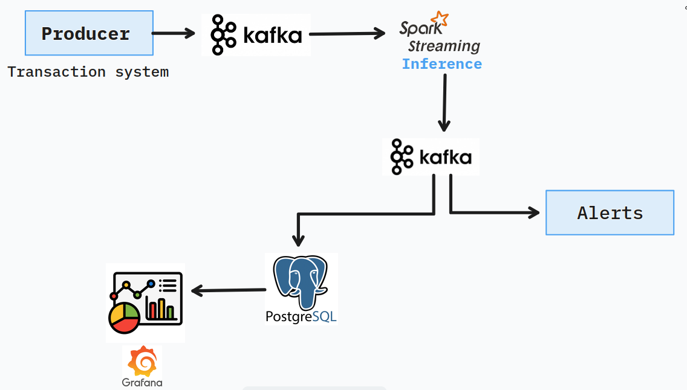
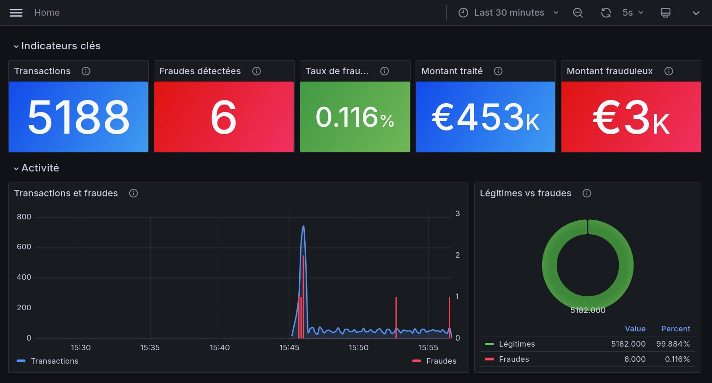
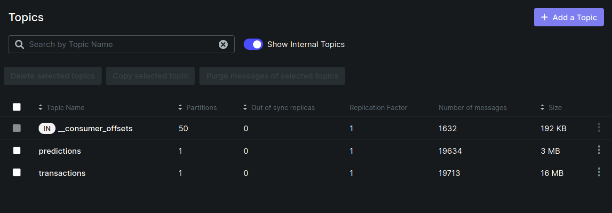
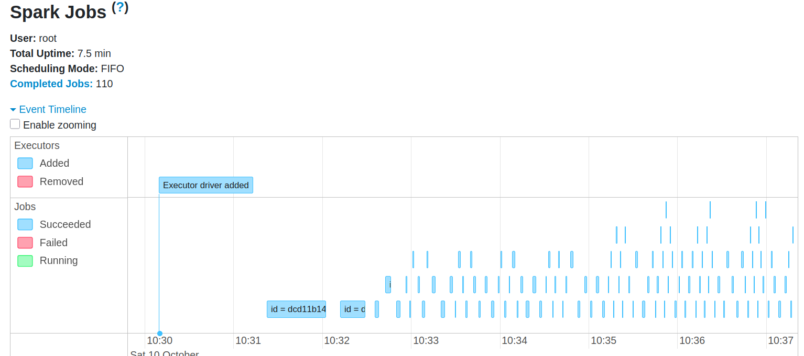
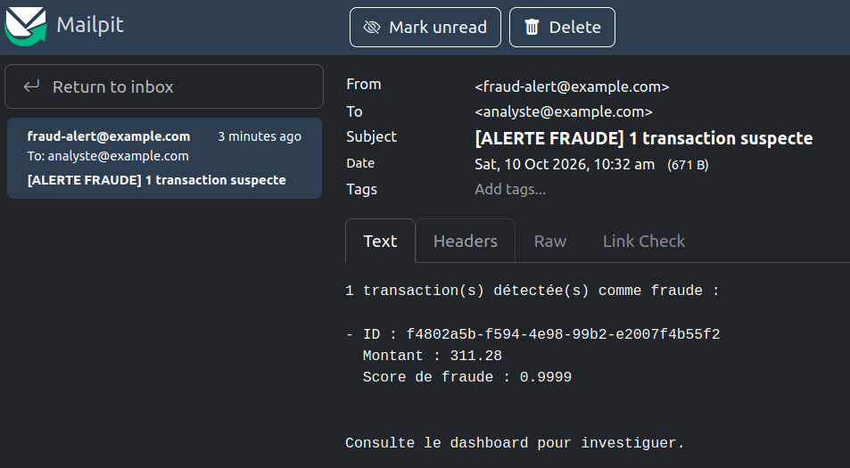

# Détection de fraude bancaire en temps réel

Pipeline de streaming qui analyse des transactions bancaires au fil de l'eau, prédit si elles sont frauduleuses avec un modèle de machine learning, stocke les résultats, les affiche sur un tableau de bord et envoie une alerte par email dès qu'une fraude est détectée.




## Fonctionnement

1. Le **producer** lit un jeu de données de transactions (dossier `data/`) et les envoie dans le topic Kafka `transactions`, à raison de 5 transactions par seconde par défaut.
2. **Spark Structured Streaming** consomme ce topic, applique le modèle entraîné (chargé depuis `models/`) et publie le résultat dans le topic `predictions`.
3. Le **db-writer** lit `predictions` et insère chaque ligne dans PostgreSQL.
4. L'**alerter** lit aussi `predictions` et envoie un email lorsque `is_fraud = 1`. Un intervalle minimum entre deux alertes évite de saturer la boîte mail.
5. **Grafana** interroge PostgreSQL pour afficher le tableau de bord en quasi temps réel.

## Technologies

| Rôle | Outil |
|---|---|
| Bus de messages | Apache Kafka 3.7 (mode KRaft, sans ZooKeeper) |
| Traitement en continu | Spark 3.5.1 Structured Streaming (PySpark) |
| Modèle | XGBoost / scikit-learn, sérialisé avec joblib |
| Stockage | PostgreSQL 16 |
| Visualisation | Grafana 11.2 |
| Supervision Kafka | Kafka UI |
| Alertes | SMTP (Mailpit en test, Gmail en réel) |
| Orchestration | Docker Compose |

## Structure du dépôt

```
.
├── docker-compose.yml
├── producer/          # envoi des transactions dans Kafka
├── spark/             # stream_inference.py, job d'inférence Spark
├── models/            # modèle entraîné (monté dans le conteneur Spark)
├── data/              # jeu de données source du producer
├── db-writer/         # consommateur Kafka vers PostgreSQL
├── alerter/           # consommateur Kafka vers email
├── postgres/          # init.sql, création de la table
├── grafana/           # provisioning et dashboards
└── screenshots/       # captures utilisées dans ce README
```

## Lancement

Prérequis : Docker et Docker Compose.

```bash
git clone <url-du-depot>
cd fdc
docker compose up --build
```

Le démarrage prend environ une à deux minutes : Kafka doit être sain avant la création des topics, puis Spark installe ses dépendances Python et télécharge le connecteur Kafka avant de lancer le job.

Pour tout arrêter :

```bash
docker compose down        # conserve les données
docker compose down -v     # supprime aussi les volumes (PostgreSQL, Grafana)
```

## Interfaces

| Service | URL | Remarque |
|---|---|---|
| Grafana | http://localhost:3000 | admin / admin, lecture anonyme activée |
| Kafka UI | http://localhost:8080 | topics, messages, consommateurs |
| Spark UI | http://localhost:4040 | état du job de streaming |
| Mailpit | http://localhost:8025 | boîte mail de test |

### Grafana
 
Tableau de bord principal, rafraîchi toutes les 5 secondes. Il présente les indicateurs clés (nombre de transactions, fraudes détectées, taux de fraude, montant traité et montant frauduleux), l'évolution du volume et des fraudes dans le temps, la répartition entre transactions légitimes et frauduleuses, l'analyse des scores du modèle, ainsi que les dernières fraudes et les transactions les plus suspectes pour l'investigation.
 


### Kafka UI

Permet de vérifier que les topics `transactions` et `predictions` existent et de suivre les messages qui y circulent.



### Spark UI

Montre le job d'inférence en cours d'exécution et les micro-batchs traités.



### Alertes email

Chaque transaction classée frauduleuse déclenche un email, visible dans Mailpit pendant les tests.



## Configuration

Les principaux paramètres se règlent dans `docker-compose.yml`.

| Variable | Service | Rôle |
|---|---|---|
| `RATE_PER_SEC` | producer | Nombre de transactions envoyées par seconde |
| `ALERT_MIN_INTERVAL` | alerter | Délai minimum entre deux emails d'alerte |
| `MAIL_FROM`, `MAIL_TO` | alerter | Expéditeur et destinataire des alertes |
| `SMTP_HOST`, `SMTP_PORT`, `SMTP_STARTTLS` | alerter | Serveur SMTP utilisé |

### Envoyer de vrais emails

Par défaut les alertes partent vers Mailpit. Pour utiliser Gmail, créer un mot de passe d'application, le placer dans un fichier `.env` à la racine (`SMTP_PASSWORD=...`), puis remplacer dans le service `alerter` :

```yaml
SMTP_HOST: smtp.gmail.com
SMTP_PORT: "587"
SMTP_STARTTLS: "true"
SMTP_USER: ton.adresse@gmail.com
SMTP_PASSWORD: ${SMTP_PASSWORD}
```

Ne pas versionner le fichier `.env`.

## Modèle

L'expérimentation (exploration des données, traitement du déséquilibre de classes, comparaison de modèles, évaluation) a été faite dans un notebook Colab :

[Notebook d'expérimentation](https://colab.research.google.com/drive/1UhbJ-OuwsT7DEYOvwLlQejHYq1JYEffv?authuser=1#scrollTo=RRWCHDk43Tls)

Le modèle retenu est exporté avec joblib dans `models/` puis chargé par `spark/stream_inference.py`.

## Limites et pistes d'amélioration

- Les topics ont une seule partition et le broker est unique : adapté à une démo, pas à de la production.
- Les identifiants (PostgreSQL, Grafana) sont ceux de développement et doivent être changés avant tout déploiement.
- Le modèle est statique : pas de réentraînement automatique ni de suivi de la dérive des données.
- Pas de tests automatisés sur les consommateurs pour le moment.

